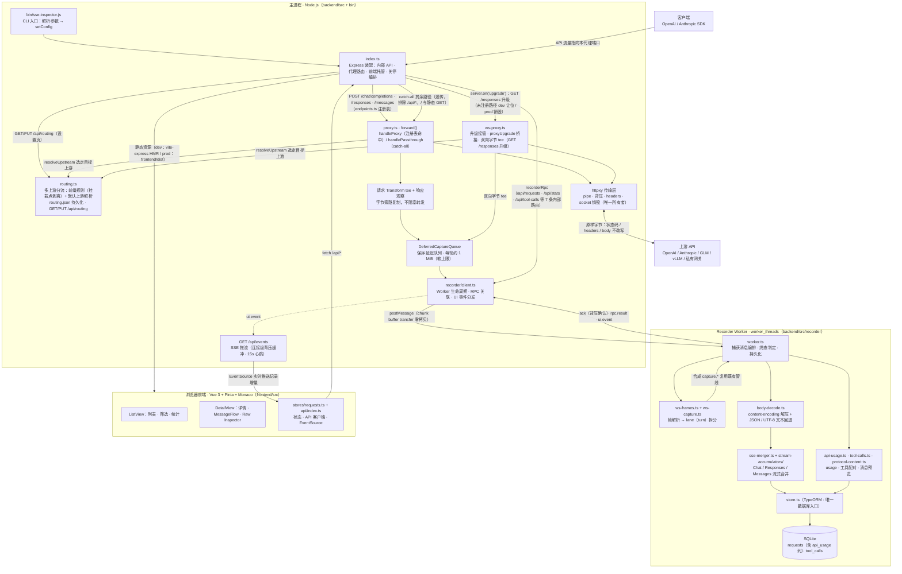
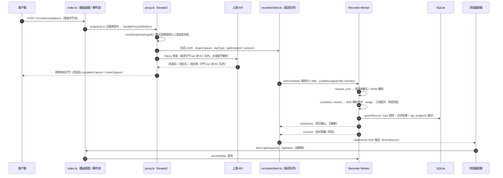

# SSEInspector 项目架构

SSEInspector 是 OpenAI / Anthropic API 的透明代理检查器：客户端把上游地址指向本代理，请求与响应字节原样转发，录制、合并与展示全部在旁路完成，不影响数据面语义。整个项目由三部分构成——主进程代理数据面（31 个 TypeScript 文件、约 4,980 行）、Recorder Worker 观察面（独立 worker_threads，持有数据库与全部解析逻辑）、Vue 3 前端（40 个文件、约 6,050 行），配套 23 个测试文件（后端 19 个、前端 4 个）。当前注册 3 个 AI endpoint（`openai-chat`、`openai-responses`、`anthropic-messages`），其余 HTTP 路径一律透传录制，`/v1/responses` 的 WebSocket 升级走独立桥接（见「典型场景」）；上游目标由 `routing.ts` 按分流规则在多个上游中选定，规则与默认上游可在设置页动态配置（见「多上游分流」）；代理与观察面之间以保序延迟队列衔接，每轮投递量以 1 MiB 为软上限，主线程零解析、零数据库访问。

对 AI 编码代理的行为约束见仓库根目录 `AGENTS.md`；本文描述架构事实与维护规则。

## 总体架构图

图中有三条贯穿全系统的路径：其一是**代理路径**，客户端流量经 Express 路由进入 `forward()`（WebSocket 升级流量经 `ws-proxy.ts` 的升级接管进入 httpxy 桥接），由 httpxy 原样转发到上游；其二是**观察路径**，转发过程中的请求与响应字节被 tee 旁路复制（HTTP 经 proxy.ts 的请求 Transform 与响应观察，WebSocket 经 ws-proxy.ts 的双向 socket tee），经延迟队列与 `postMessage` 进入 Recorder Worker，在那里完成解码、合并与落库；其三是**展示路径**，前端通过内部 REST API 拉取数据，并通过 `/api/events` 的 SSE 通道接收实时增量。三条路径彼此隔离：观察路径落后或崩溃不影响代理路径，代理路径不等待观察路径。

## 一次请求的完整数据流

时序中的每一步都服务于同一组不变量。主线程只做字节搬运：请求体经原生 `Transform` tee 后交给 httpxy 的 `buffer` 选项，响应体在 `proxyRes` 事件后观察复制，两路 chunk 与生命周期控制消息进入同一保序队列，复制与投递推迟到后续事件循环，每轮投递量以 1 MiB 为软上限（单个超过 1 MiB 的 chunk 单轮仍全量投递）。队列没有 pending 上限也没有截断——Worker 慢或大体量并发时主线程内存可无限增长（已知风险，换取「完整记录、绝不截断」的产品语义）。请求身份在进入 `forward()` 时一次确定：注册表命中的走对应 `apiType/apiEndpoint`，未命中的固定 `passthrough`，并从请求头提取会话标识（已知 session 头列表优先，任意 `*-session-id` 后缀头兜底）。上游目标同样在进入转发前由 `routing.ts` 按分流规则一次解析（细则见「多上游分流」），记录的 `upstream_url` 即最终目标。

终态判定全部在 Worker 内完成。AI endpoint 依据 terminal SSE 事件（如 `response.completed`）判断客户端提前关闭时结果是完整还是部分错误；透传记录不做协议判断，只按通用完成 / 中断状态落库。`request_aborted`（上传中断，记 499）只持久化已捕获字节，不解析未完成请求。Worker 异常退出时代理继续透传、内部 API 返回 503，并按 1s / 2s / 5s 退避重启；进程收到 SIGINT / SIGTERM 后先停止接收新连接，Worker 有 4 秒优雅收尾加至多 1 秒强制终止，总关停时间不超过 5 秒。

## 典型场景

HTTP 流量场景共用同一条 `forward()` 管线，差异只在入口判定与观察面分支，入口判定由 `endpoints.ts` 注册表完成（三个 AI endpoint 均以 POST 方法注册）；WebSocket 流量走独立的升级接管路径，不经过 Express。

### OpenAI 协议流量

`POST /chat/completions` 与 `POST /responses` 命中注册表，走 `handleProxy`，capture 身份为对应的 openai endpoint。流式响应在 Worker 侧合并：Chat 走 chunk 增量合并，Responses 以 `response.output[]` snapshot 为唯一事实源；终态由 terminal SSE 事件判定，客户端提前关闭时据此区分完整结果与部分错误。字段保留细则见「流式合并维护规则」。

### Claude 协议流量

`POST /messages` 命中 `anthropic-messages`，与 OpenAI 流量共用同一条管线，差异只在 accumulator 与 usage 提取；字段保留细则（引用、thinking 签名、未知块与缓存 usage 字段）见「流式合并维护规则」。

### WebSocket 流量（Responses WS 模式）

WebSocket 升级请求（`GET /v1/responses` 携带 `Upgrade: websocket` 头）不进入 Express——Node 将升级请求作为 `'upgrade'` 事件而非 `'request'` 事件分发，由 `ws-proxy.ts` 在 `http.Server` 上接管。命中注册表 `wsRoutePattern`（当前仅 `openai-responses`）的升级请求经 httpxy 自带的 `proxyUpgrade()` 建立上游 WebSocket（ws / wss，随上游 scheme 派生）桥接，101 回写与双向管道由 httpxy 完成；入口剥离 `sec-websocket-extensions` 请求头（permessage-deflate 是逐跳扩展，剥离后两个方向帧均不压缩），主线程对两个方向的原始字节做被动 tee，与 HTTP 数据面的 body tee 完全对称，不解析任何帧语义。字节 tee 必须在桥接建立之后挂载：提前挂 data 监听会把流切到 flowing 模式，拨号期间到达的帧会被 tee 独占消费而丢失转发。

帧解析与 lane 记录全部在 Recorder Worker 内（lane 指同一 WS 连接内以 `stream_id` 区分的并发会话维度）：`ws-frames.ts` 纯函数解析器切分双向字节流（掩码解除、分片重组），`ws-capture.ts` 把每个 `response.create` 生命周期（一个 turn）翻译成合成的 capture.* 消息，经同一消息链复用全部既有管线——server 信封解开后内层事件序列化为 `data:` 行进入 responseText（live 推送、合并、终态判断三条路径直接复用），原始信封以 NDJSON 行存入 `response_body`。记录的 method 为 `WS`，新增可空 `stream_id` 列承载 lane 维度（隐式默认 lane 落库为 null），同一 `stream_id` 顺序多个 turn 产生多条记录，上一 turn 未结束时同 lane 收到新 `response.create` 则旧 turn 按错误收尾。请求级 `error` 信封终结对应 turn 且不关闭连接；连接断开（FIN 与 RST 均视为该侧离开）时，下游离开把未完成 turn 转译为 `capture.closed`（已有 terminal 事件则记为完成，否则部分保存），上游离开或出错转译为 `capture.failed`；坏 JSON 文本帧与终态后迟到的信封被跳过且原文不落任何记录（与 `response.steer` 同属当前版本的已知限制，后者仅透传不单独记录）。

升级处理器的分流判定先于路径注册表：只有 `Upgrade` 令牌为 `websocket` 且携带 `Sec-WebSocket-Key` 的请求才视为 WebSocket 升级。未命中注册表的 WebSocket 升级路径：开发模式让位（不碰 socket，供 Vite HMR 等监听者处理），生产模式显式销毁——挂了任意 upgrade 监听后 Node 不再自动销毁连接。带升级语义但不是 WebSocket 的请求（典型如 JDK HttpClient 在默认 HTTP/2 版本下对明文 `http://` 地址每个新连接先发的 h2c 升级尝试，即 `Connection: Upgrade` + `Upgrade: h2c` + `HTTP2-Settings`）按 RFC 语义优雅拒绝升级：处理器删除 `Upgrade` 与 `HTTP2-Settings` 头、从 `Connection` 头剥除对应令牌后，用 `req.rawHeaders` 重建请求字节塞回 socket，经 `server.emit('connection')` 重新走普通 HTTP/1.1 请求管线，客户端收到普通响应并在原连接上继续使用 HTTP/1.1——若直接销毁，这类客户端的每个请求都会收到零字节重置。被剥离的都是逐跳头（`filterHeaders` 转发上游时本就会剥除），上游收到的请求不变，仅记录中的请求头展示与线上原始字节存在此差异。桥接带防重入护栏（WeakSet 标记，重复进入即销毁）：若剥离失效导致重建字节再次触发 upgrade 事件，会形成解析循环耗尽内存。

### 请求与等待首包阶段

记录在请求体接收完成时（`request_end`）即写入数据库，该时刻通常在请求发出后毫秒级以内：此时 `finished = pending`、`status = 0`，读取侧派生状态为「等待响应」，列表随即可见（upsert 自带 SSE `update` 推送，无需等待轮询），请求体与 `model` 字段此时均已解析。上游返回响应头（`response_start`）后 `status` 列更新，同一行自动派生为 `streaming`（传输中）；首个 body chunk 到达前 `streamText` 为空。详情页流式卡片的渲染条件是 `isStreaming` 而非 `isStreaming && streamText`，空内容时同样显示「实时接收中…」卡片，`StreamLive` 的 `min-height: 3em` 保证卡片有可见高度；列表页预览列以「等待响应…」「流式传输中…」分别标识两个阶段（状态徽章为「等待响应」/「传输中」）。上游在请求体接收结束前即返回响应的早响应场景由 Worker 兜底：落库由响应阶段的 streaming 记录接管（请求体仍随该记录入库），请求阶段不再重复写入。

### 透传流量

未命中注册表且未被排除的路径进入 catch-all `handlePassthrough`（排除规则：`/api/*` 前缀、根路径 `/`、带扩展名的 GET 静态请求），与 AI 流量共用 `forward()`：同样生成 UUID、tee 字节、落库，身份固定为 `passthrough`。Worker 对透传短路全部协议逻辑（细则见「分层职责」的 Recorder Worker 一节），详情页走 raw inspector（headers + 正文多查看器，见「分层职责」的前端一节），列表以灰色「透传」徽章区分。

### 多上游分流

上游目标不是全局单值，而是由 `routing.ts` 在每次转发前按同一张规则表解析，HTTP 代理路由、catch-all 透传与 WebSocket 升级三处消费点行为一致。规则表为有序数组：自上而下取第一条启用且前缀命中的规则；前缀按路径段边界匹配（`/v1` 命中 `/v1` 与 `/v1/...`，不命中 `/v1foo`）；命中规则的请求按挂载点语义剥离前缀后转发（`/easytier/v1/models` 上游收到 `/v1/models`，路径恰为前缀时剥离为 `/`，query 串原样保留；需要在上游保留前缀时，把前缀写进规则上游地址的路径即可组合还原），根前缀 `/` 无可剥离；未命中则回落默认上游，默认上游不剥离、转发完整请求路径；两者皆无时 HTTP 请求返回 503 状态码与中文错误信息，WebSocket 升级回写 503 后关闭连接，被拒绝的请求不产生录制记录。

配置持久化在与 SQLite 同目录的 `routing.json`（数据卷内，随库备份），保存走整文档替换：校验通过后先写入临时文件并原子替换目标文件，再整体替换内存快照，因此保存即时生效、无需重启，在途请求继续读旧快照。默认上游有两个来源：CLI `--upstream`（可选参数）与设置页保存值；显式传入时以 CLI 传入值为准（仅本次运行生效，不回写文件），设置页会显示覆盖提示。

启动时校验：生效默认上游与启用中的规则同时为空时，启动阶段即退出进程。上游地址必须使用 http(s) 协议，允许携带路径前缀（规则命中时与剥离前缀后的路径拼接，默认上游与完整请求路径拼接，与历史 `--upstream` 的拼接语义一致），不得携带 query、hash 或凭证；CLI 传入值与规则中的上游按同一规格校验，CLI 值非法时在启动阶段即终止进程。WebSocket 升级与 HTTP 同语义：分流解析先于路径注册表（带前缀的 `/easytier/v1/responses` 剥离后按 `/v1/responses` 命中注册表的 `wsRoutePattern`），发往上游的路径同样剥离前缀，录制记录保留客户端原始路径。

设置页（`SettingsView`，入口在列表页顶栏）提供默认上游编辑、规则的增删改、上移下移排序与启用停用开关，保存失败的校验错误以中文清单展示。路由配置不属于录制数据，不经 Recorder Worker 与数据库，主线程只在启动与保存两个时机对 `routing.json` 做一次同步读写，数据面每请求只读内存快照（不触碰「代理主线程不访问数据库」红线）。

### 数据轮转

录制数据按数据量轮转：记录总数超过「触发阈值」时，把最老的记录删除到只剩「保留量」，删除前先把这部分记录（原始列全字段）与关联 tool_calls 导出为数据库同目录 `retention-archive/` 下的 `archive-<时间戳>.json` 归档文件，设置页可下载（文件名白名单校验以防路径穿越）。单次轮转最多处理 500 条——大批量首次清理由后续探查分批消化，归档以流式逐行写出避免单串内存峰值；两个阈值设有上界（100 万）作为误配防线；tool_calls 依赖数据库外键级联随主记录删除。主线程每 60 秒经 Worker RPC 探查一次记录总数是否超过触发阈值（未启用时每次仅一次 count 查询），设置页也可手动立即执行；导出与删除等全部数据操作在 Recorder Worker 的 `retention.run` RPC 内完成，Worker 串行消息链保证删除与录制互斥。配置存于数据库同目录的 `retention.json`（与 routing.json 同模式：校验 → 原子写 → 内存快照），主线程负责保存，Worker 每次执行前强制重读文件，保证两端一致；未启用时不执行清理（设置页以黄条提示该状态），启用时触发阈值与保留量必填，且保留量必须小于触发阈值。归档文件的自动清理与 VACUUM 磁盘回收为后续版本的非目标。

### 压缩请求体

代理转发不感知压缩：`/api` 以外的路由不挂任何 body 消费型中间件，tee 复制的是原始压缩字节，转发语义不受影响（这也是代理路由绕开 `express.json` 的原因——body-parser 会消费并破坏压缩体，且对 zstd 等编码抛错）。压缩只在观察面解开：请求头 `content-encoding` 随 capture metadata 进入 Worker，`body-decode.ts` 按 identity / gzip / deflate / br / zstd 解压后再 `JSON.parse`；解码失败只记录 error 不抛出，绝不影响代理透传。

### 时间与耗时记录

每个请求在进入 `forward()` 时取一次 `startedAt`（`Date.now()`）并生成 ISO 8601 格式的 `timestamp`，两者随 capture metadata 进入 Worker。主线程日志的 `durationMs` 与 Worker 各持久化点（请求阶段 / 完成 / 部分保存 / 中断 / 上游失败）的 `record.durationMs` 均由 `Date.now() - metadata.startedAt` 计算——主线程与 Worker 两侧的计算发生在不同时刻、数值可能略有差异，但都取自同一个 `startedAt`，语义一致。请求阶段落库的记录携带当时的耗时（即从请求发出到请求体接收完成的时长），响应开始后的流式实时快照（`publishLiveSnapshot`，与持久化点不同，仅推送不落库）会继续刷新记录中的该值。

## 分层职责

### 主进程：代理数据面

`proxy.ts` 的 `forward()` 是唯一转发入口，`handleProxy` 与 `handlePassthrough` 只差一个 `EndpointDefinition` 参数——注册表命中与未命中共用同一条 capture 管线，均生成 UUID 并录制。httpxy 是传输的唯一所有者（pipe、背压、headers 改写、keep-alive、双向 socket 销毁），转发参数固定为 `changeOrigin: true`、`xfwd: false`、`selfHandleResponse: false`；数据面不引入手写 `http.request` 或 `res.write` 循环。客户端先关闭时由 httpxy 终止上游连接，只记录 `downstream_closed`；上游异常才输出转发失败日志。

### 主进程：内部 API 与前端托管

`index.ts` 装配全部路由：`/api/*` 挂 compression 与 JSON body 解析（SSE 响应显式跳过压缩）；代理路由不经过任何 body 消费型中间件——压缩请求体（gzip / deflate / br / zstd）必须保持原始字节，body-parser 也会对不支持的编码抛错。`/api/events` 为每个连接维护一个 `RecorderUiEventBuffer`：写回压时事件进缓冲，`drain` 后补发，每 15 秒发一次注释心跳。前端托管双模式：开发模式经 vite-express 在 `frontend/` 源码目录启动 Vite dev server 提供 HMR，生产模式直接服务 `frontend/dist`（hash 路由，无需 SPA fallback）。

### Recorder Worker：观察面

`worker.ts` 是数据库、SSE 合并、usage、preview 与工具配对的唯一运行时所有者。主线程与 Worker 之间的消息协议（`recorder/protocol.ts`）为强类型联合：捕获侧为 `capture.` 前缀的十一条消息：HTTP 生命周期八条（`start`、`request_chunk`、`request_end`、`response_start`、`response_chunk`、`complete`、`closed`、`failed`）与 WebSocket 连接三条（`ws_open`、`ws_chunk`、`ws_close`）；查询侧 `rpc` 与关停侧 `shutdown`；回程 `ready / ack / ui.event / rpc.result / fatal`。`apiEndpoint === passthrough` 时 Worker 短路协议逻辑：不合并、不写 usage、不写 tool_calls、不做 terminal 判断，请求体仍可解码为 JSON 或 UTF-8 文本，响应保留完整 raw。

### 存储：不做迁移的检查记录库

TypeORM 以 `synchronize: true` 同步 schema，不维护 migration；实体不兼容变更时删除旧 DB 重建。`requests` 表含必填 `api_type` 与 `api_endpoint` 列，读路径以这两列为准，path 只用于展示与搜索；记录身份经 `resolveRecordIdentity` 单一入口校验（透传要求两列同时为 `passthrough`，AI 校验 path 与 endpoint 一致）。慢 SQL（超过 200ms）只输出耗时与 SQL 文本，不输出参数与结果。

### 前端：展示面

列表页（`ListView`）承担筛选与统计，顶栏顺序为 `总计 · OpenAI · Anthropic · 透传 · 进行中 · 错误`（「进行中」= 等待响应与传输中两态之和）。列表的速度列不做实时估算：进行中的记录显示状态文案（等待响应 / 接收中，速度列的短文案），终态记录以 usage 返回的输出 token 为主计算 `tok/s`，usage 缺失时以响应字符数（`responseChars`，终态落库时取原始响应文本长度写入）兜底显示 `字/s`，两种单位明确区分，不做 token 数的换算猜测。详情页（`DetailView`）按记录身份分叉：AI 记录走协议合并视图（`MessageFlow` 消息卡片流、工具配对、上下文组成分析），透传记录走 raw inspector（headers + 正文多查看器）。正文块（`BodyInspector`）提供「原始 + 按内容格式预览」的查看器切换：JSON 提供格式化视图、XML/HTML 提供缩进视图（`formatPrettyXml` 尽力而为，不校验标签配对）、文本类提供 Markdown 渲染（默认选中，与消息卡片共用 `MarkdownRender` 渲染管线）、form 提供字段表；AI 响应体的 JSON 查看器展示协议合并结果。消息卡片（`BaseTextCard`）对消息文本做同款识别：内容本身是对象/数组形态的 JSON 或 XML 字符串（如模型输出的结构化标注）时默认展示对应格式化视图，否则保持 Markdown 渲染与原文两态。可用查看器按 Content-Type 优先、内容嗅探兜底给出；内容过大时 JSON / XML / Markdown 查看器默认退回原始，仍可手动切换，格式化在首次切换时懒生成。前端不从 path 推断协议，一律使用 API 返回的 `apiEndpoint`。大体积内容按需挂载：请求体和响应体的 Monaco 编辑器只在对应折叠区打开时创建，上下文组成分析在独立的 `request-analysis.worker.ts` 中解析，主线程不同步解析大型请求体。

## 关键目录与文件职责

| 路径 | 职责 |
|------|------|
| `bin/sse-inspector.js` + `bin/parse-args.js` | CLI 入口（CJS）：参数解析、config 填充、dev（tsx 源码）/ prod（dist 产物）分流 |
| `backend/src/index.ts` | Express 装配：内部 API、代理路由、静态资源、SSE 事件流、5 秒关停编排 |
| `backend/src/proxy.ts` | 数据面转发与字节 tee，`forward()` 唯一转发入口 |
| `backend/src/routing.ts` | 多上游分流：前缀规则与默认上游解析、校验、routing.json 持久化 |
| `backend/src/retention.ts` | 数据轮转：retention.json 配置读写与校验、轮转判定纯函数 |
| `backend/src/ws-proxy.ts` | WebSocket 升级接管：httpxy `proxyUpgrade` 桥接、入口剥离压缩扩展、双向字节 tee |
| `backend/src/recorder/ws-frames.ts` | WS 帧解析纯函数（掩码解除、分片重组、控制帧观察） |
| `backend/src/recorder/ws-capture.ts` | WS lane 管理器：帧 → turn → 合成 capture.* 消息（复用既有管线） |
| `backend/src/config.ts` | 中央配置容器，CLI 启动时经 `setConfig()` 填充，无环境变量回退 |
| `backend/src/endpoints.ts` | AI endpoint 唯一注册表，路由模式与 provider 从此派生 |
| `backend/src/types.ts` + `record-identity.ts` | `as const` 协议常量与 `resolveRecordIdentity` 记录身份入口 |
| `backend/src/recorder/client.ts` | Worker 生命周期、RPC 关联、延迟队列投递、重启退避 |
| `backend/src/recorder/capture-queue.ts` | 保序延迟队列本体（每轮约 1 MiB drain 软上限，无 pending 上限） |
| `backend/src/recorder/ui-event-buffer.ts` | `/api/events` 连接级背压缓冲 |
| `backend/src/recorder/protocol.ts` | 主线程与 Worker 的强类型消息协议 |
| `backend/src/recorder/worker.ts` | 观察面主体：解码、合并、usage、工具配对、持久化 |
| `backend/src/sse-parser.ts` | SSE 底层解析（raw 文本 → `SSEChunk[]`，无业务语义） |
| `backend/src/sse-merger.ts` + `stream-accumulators/` | 按 endpoint 分派的流式合并门面与三个 accumulator |
| `backend/src/body-decode.ts` | 请求体解压 + JSON 解码纯函数（失败只返回 error 不抛） |
| `backend/src/store.ts` + `entity/` | 持久化、列表摘要、统计、相邻记录与工具调用查询 |
| `backend/src/api-usage.ts` | usage 写入与 endpoint 专属 token 字段提取 |
| `backend/src/protocol-content.ts` + `tool-calls.ts` | 协议内容提取与工具调用 / 结果配对 |
| `backend/src/logger.ts` + `db/slow-query-logger.ts` | Pino 统一日志入口与慢 SQL 日志 |
| `frontend/src/views/` | `ListView`（列表筛选统计）、`DetailView`（详情分叉视图）与 `SettingsView`（多上游分流设置） |
| `frontend/src/components/` | 消息卡片族（user / assistant / thinking / tool call 等）、`MessageFlow`、`BodyInspector`（正文多查看器）、`MarkdownRender`（共享 Markdown/图表渲染）、`StreamLive`、`TokenSpeed`、`HeadersViewer`、`DiffViewer` 等 |
| `frontend/src/stores/requests.ts` + `api/index.ts` | Pinia 状态与 `/api` 客户端（含 EventSource 实时更新） |
| `frontend/src/response-flow.ts` 等 | 前端纯函数：响应卡片 descriptor、body 展示、token 速度、上下文组成 |
| `frontend/src/workers/request-analysis.worker.ts` | 请求体上下文组成分析（避免主线程解析大 body） |

## 内部 API 一览

| 路由 | Worker RPC | 用途 |
|------|------------|------|
| `GET /api/requests` | `requests.list` | 分页列表；`filter`（all / openai / anthropic / passthrough / streaming / error）与 `sessionId` 会话过滤正交组合 |
| `GET /api/requests/:id` | `requests.detail` | 单条记录详情（headers、raw body、合并结果） |
| `GET /api/requests/:id/prev` · `/next` | `requests.prev` / `requests.next` | 同一会话内的相邻记录 |
| `GET /api/requests/:id/neighbors` | `requests.neighbors` | 相邻记录摘要 |
| `GET /api/stats` | `requests.stats` | 分类计数（含 passthrough） |
| `GET /api/events` | ——（`ui.event` 直通） | SSE 实时事件流 |
| `GET /api/tool-calls` | `tools.list` / `tools.pair` | 按 requestId 列出工具调用，或按 `toolName` + `toolCallId` 配对结果 |
| `GET /api/routing` | ——（主线程 `routing.ts`） | 读取分流配置状态（CLI 上游、持久化默认上游、生效默认上游与规则列表） |
| `PUT /api/routing` | ——（主线程 `routing.ts`） | 整文档替换分流配置；校验失败返回 400 与中文错误清单，成功即时生效 |
| `GET /api/retention` | `requests.stats` + `retention.archives`（配置读取走主线程） | 读取轮转配置、当前记录总数与归档文件列表 |
| `PUT /api/retention` | ——（主线程 `retention.ts`） | 保存轮转配置（retention.json 原子写）；启用时触发阈值与保留量必填，Worker 每次执行前强制重读文件 |
| `POST /api/retention/run` | `retention.run` | 手动立即轮转：超限时先导出归档再删除最老记录 |
| `GET /api/retention/archives/:name` | ——（主线程文件 IO） | 下载归档文件（文件名白名单校验防路径穿越） |

## 流式合并维护规则

修改 `sse-parser.ts`、`sse-merger.ts`、`stream-accumulators/*` 或 `types.ts` 中的流式类型时，必须同步补充回归测试，且 `npm run test:sse` 与 `npm run build` 通过后才算完成。具体字段保留规则：

1. Anthropic `message_delta.usage` 是累计 usage，应整体合并并保留 `input_tokens`、`output_tokens`、`cache_creation_input_tokens`、`cache_read_input_tokens`、`service_tier`、`server_tool_use` 以及供应商扩展字段，不得只合并 `output_tokens`。
2. OpenAI-compatible 供应商可能返回官方类型之外的字段（例如 `reasoning_content`），合并器应保留有用扩展字段，避免过度收窄类型。
3. Anthropic 合并需要保留引用、thinking 签名和未知块：`citations`、`signature`、`redacted_thinking`、`_raw`、`_deltas`。
4. OpenAI Chat 合并需要兼容旧版函数调用和安全字段：`function_call`、`refusal`、`logprobs`、`prompt_filter_results`、`content_filter_results`。
5. Responses API 以完整 `response.output[]` snapshot 为唯一输出事实源，finalize 时派生 UI 便捷字段（`output_text`、`reasoning_text`、`tool_calls`、`usage`、`error`、`incomplete_details`）。lifecycle response 的所有非 `undefined` 顶层字段必须保留（包括 `null` 与扩展字段）；terminal `output` 为数组时是最终权威快照，为 `null` 或非法结构时不得清空已累计 item；done 状态按具体 index 维护，不使用 response 级全局布尔值。
6. `response.metadata` 等无 snapshot 语义的私有事件不污染合并响应，原始内容仅存于 raw SSE。
7. 面对第三方兼容流保留未知 response 字段与未知 output item，UI 以 Raw JSON 卡展示；未知事件不得用于 endpoint 推断。

## 运行方式与打包

开发模式：`npm start -- --upstream http://localhost:8000 --db-path ./data.db`（同进程 tsx 加载 TS 源码，前端 HMR 由 vite-express 提供）。生产模式：`npm run build:all` 后执行 `node bin/sse-inspector.js`，或直接 `npx` GitHub Release tarball。CLI 参数为 `--upstream`（可选；显式传入时覆盖设置页保存的默认上游，仅本次运行生效）、`--port`（默认 3000）、`--db-path`（必填）、`--dev`、`-h/--help`；多上游分流规则与持久化默认上游经设置页维护（存于数据库同目录 `routing.json`）。运行时要求 Node.js 20.19+ 或 22.12+，不支持 21。

日志经 `LOG_FORMAT`（pretty / json，默认 pretty）与 `LOG_LEVEL`（默认 info）控制，非法值在启动阶段失败。打包以 GitHub Release tarball 分发（不发 npm）：push `v*` tag 触发 `.github/workflows/release.yml`，产物含 `bin/`、`dist/`、`frontend/dist/`；`better-sqlite3` 为原生模块，`npx` 时由 npm 下载预编译二进制，小众平台可能触发 node-gyp 编译。

## 文档同步规则

修改代码后，按下述情形判断是否同步更新本文档：

- 新增、删除或重命名关键目录、文件 → 更新「关键目录与文件职责」。
- 新增或修改内部 API、端口、服务、协议 → 更新「内部 API 一览」与相关章节。
- 修改 SSE 合并架构或 provider accumulator 职责 → 更新「流式合并维护规则」。
- 架构层面的数据流或生命周期变化 → 更新总体架构图与时序图。
- 行为约束类内容写入 `AGENTS.md`，不在本文重复。
